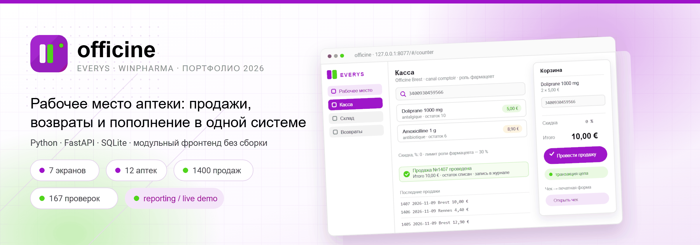
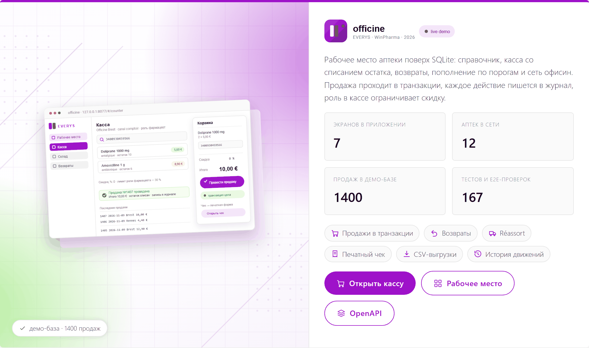
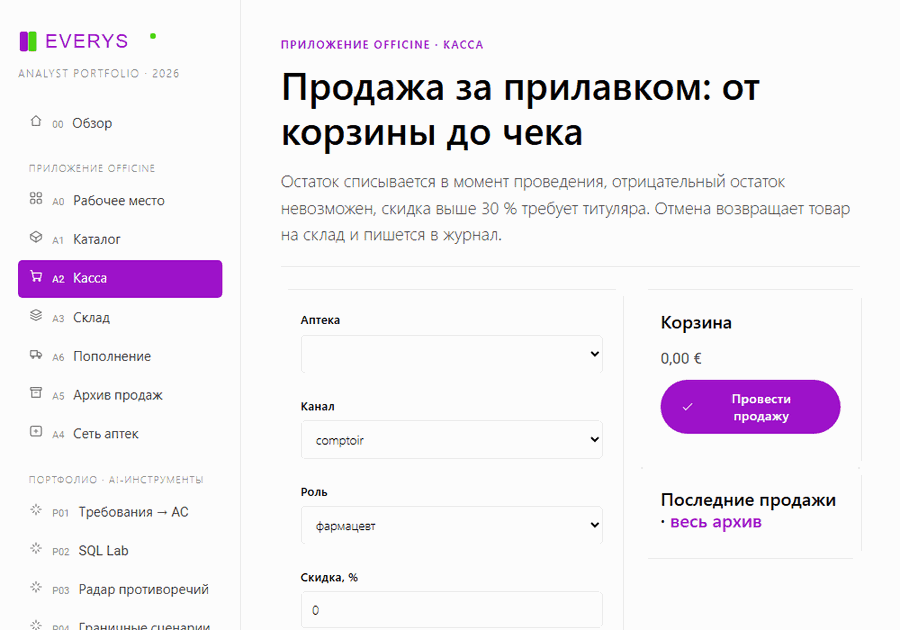
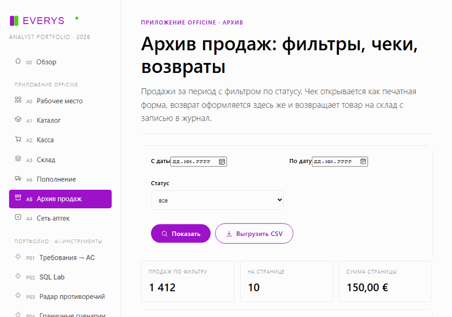
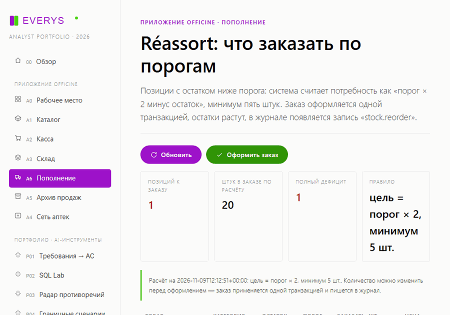

# Everys · Portfolio analyste système / produit

Projet de démonstration pour le poste d'**analyste système / produit** chez Everys (France,
produit **WinPharma**, bureau de Moscou).

Huit outils AI-native fonctionnels sur le domaine de l'officine : de l'analyse des spécifications et
des critères d'acceptation jusqu'au contrôle de stabilité de version. Un seul service local, une
seule interface, aucun service externe ni clé d'API — le tout démarre hors ligne sur `127.0.0.1`.

```
Everys (France) · WinPharma · édition de logiciels pour pharmacies depuis 1994
plus de 7000 officines · 3 centres de développement : Moscou, Bretagne, Silicon Valley
```



---

## Démarrage rapide

```powershell
cd everys-analyst-portfolio
$env:PYTHONUTF8 = "1"
$env:PYTHONPATH = "."
python -m uvicorn app.main:app --host 127.0.0.1 --port 8077
```

Ouvrir <http://127.0.0.1:8077> pour l'interface, <http://127.0.0.1:8077/api/docs> pour l'OpenAPI.

Ou en une commande : `.\tools\run.ps1`.

Contrôle qualité (lint du contrat de style, tests, test de fumée de l'API, syntaxe du frontend) :

```powershell
.\tools\check.ps1
```

**Environnement.** Python 3.11+ (validé sur 3.14.7), FastAPI 0.162, Uvicorn 0.54, httpx, pytest —
déjà installés. Node.js ne sert qu'à vérifier la syntaxe des modules ES (`node --check`) ;
l'interface n'a pas d'étape de build.

---

## Les huit projets

| # | Outil | Besoin de l'analyste | Mécanique IA | Endpoint |
|---|-------|----------------------|--------------|----------|
| P01 | Exigences → critères d'acceptation | User story sans AC | RAG BM25 sur le corpus + extraction de contraintes + Given/When/Then + vérification | `POST /api/p01/generate` |
| P02 | SQL Lab | Question métier → chiffres | Détection d'intention, SELECT gabarit, garde « SELECT only » et LIMIT forcé | `POST /api/p02/query` |
| P03 | Radar de contradictions | 9 spécifications qui se contredisent | Normalisation des énoncés, comparaison des valeurs numériques et modales | `POST /api/p03/scan` |
| P04 | Cas limites | Le happy path est testé, pas les bornes | Extraction des seuils, génération ±1, droits, concurrence, idempotence | `POST /api/p04/generate` |
| P05 | A/B Lab | Hypothèse validée « à l'œil » | Test z sur deux proportions, intervalle de confiance, taille d'échantillon | `POST /api/p05/test` |
| P06 | Integration Watch | La télétransmission casse sur TLS et timeouts | Sonde d'endpoints, expiration du certificat, version TLS, checklist SLA, validateur SOAP | `POST /api/p06/probe` |
| P07 | Release Gate | Version livrée sans plan de retour arrière | Score pondéré des portes, blocages, procès-verbal RU/FR | `POST /api/p07/assess` |
| P08 | Glossaire FR↔RU | L'équipe de Moscou lit les spécifications françaises | Recherche bilingue sur 30 termes, couverture du corpus, lacunes terminologiques | `GET /api/p08/search` |

### Ce que montre chaque outil

**P01.** « En tant que pharmacien je veux délivrer une ordonnance partiellement… » devient un jeu de
critères `Given / When / Then` avec leur source (`SPEC-DISP-02#3`), des questions ouvertes et des
risques. Chaque critère est confronté au fragment de document qui le porte : c'est la validation
critique de la sortie IA exigée par l'offre.

**P02.** « Top 10 des produits par chiffre d'affaires » devient un `SELECT … JOIN … GROUP BY … ORDER BY`
sur une base réelle (1400 ventes, 3450 lignes, 12 officines, 30 références). Toute tentative de
`DELETE` ou `UPDATE` est bloquée par la garde, y compris en SQL libre.

**P03.** Le corpus contient des écarts volontaires : remise **30 %** (doc. 05) contre **20 %**
(doc. 09), TLS **1.3 obligatoire** contre **1.2 minimum**, retransmission sous **48 h** contre **24 h**,
conservation **2–8 °C** contre **2–6 °C**. Le radar apparie les énoncés, qualifie la gravité et
propose une action.

**P04.** « Remise maximale autorisée 30 % » produit les bornes 29,9 / 30 / 30,1 %, complétées par des
presets métier : dernière unité vendue sur deux caisses, double contrôle par le même utilisateur,
rejeu du même `idFlux`, écart de 2,1 °C pendant 31 minutes.

**P05.** Test à 2400 + 2400 visiteurs, 480 et 528 conversions : +10 % de gain relatif, p = 0,0890,
intervalle contenant zéro → verdict « poursuivre le test », pas « déployer ».

**P06.** Sonde de démonstration sur trois cibles : certificat expirant dans 12 jours, réponse 503 à
1240 ms → SLA `blocked`. Le mode réel sort sur le réseau mais bloque `localhost` et les plages privées.

**P07.** Huit portes pondérées ; un plan de retour arrière non testé annule le verdict quel que soit
le score (66 % → `no-go`), et le procès-verbal est généré en deux langues.

**P08.** 30 termes d'officine définis et illustrés : `ordonnance`, `tiers payant`, `créance`,
`rupture`, `CIP13`, `chaîne du froid`, `idFlux`. La recherche fonctionne dans les deux sens et
signale les lacunes du dictionnaire.

---

## Application officine — poste de travail de la pharmacie



Le portfolio est devenu une application qui fonctionne : même base `data/officine.db`, mais en
écriture. Cinq écrans dans la barre latérale, groupe « Application officine ».

| L'officine | Pilotage du réseau |
|------------|--------------------|
|  |  |

| Écran | Rôle | Endpoints |
|-------|------|-----------|
| Poste de travail (`#/app`) | CA sur 30 jours, ruptures, top produits, dernières ventes, journal | `GET /api/app/overview` |
| Catalogue (`#/catalog`) | Recherche nom/DCI/CIP13, prix et stock, réassort, nouvel article, suppression | `GET/POST /api/app/products`, `PATCH/DELETE /api/app/products/{cip}`, `POST …/restock` |
| Caisse (`#/counter`) | Panier, remise, vente, ticket, annulation | `GET/POST /api/app/sales`, `POST /api/app/sales/{id}/cancel` |
| Stock (`#/stock`) | Articles sous le seuil, réassort rapide | `GET /api/app/stock` |
| Réassort (`#/reorder`) | Besoin calculé par seuil et commande en une transaction | `GET/POST /api/app/reorder` |
| Réseau (`#/pharmacies`) | CA et panier moyen des 12 officines | `GET /api/app/pharmacies` |

**Invariants tenus par le backend** (27 tests dans `tests/test_officine.py`) :

1. Une vente s'exécute dans une transaction `BEGIN IMMEDIATE` : soit toutes les lignes sont
   décrémentées et le ticket créé, soit rien ne change.
2. Le stock ne passe jamais en négatif : quantité demandée > stock → `409` avec le restant.
3. Deux lignes du même CIP sont fusionnées : impossible de décrémenter deux fois la même position.
4. Rôle en caisse : pharmacien jusqu'à 30 %, titulaire jusqu'à 100 %. Au-delà → `409`,
   le rôle et le montant de la remise sont journalisés.
5. L'annulation remet la marchandise en stock et passe le ticket en `annulee` ; double annulation → `409`.
6. Un article déjà vendu ne peut pas être supprimé (`409`) — seul le stock peut être mis à zéro.
7. Chaque action est écrite dans la table `journal` : qui, quoi, quand, sur quel objet.

À tester à la main : « Caisse » → ajouter deux articles → « Провести продажу » → le stock du
« Stock » diminue, une ligne apparaît dans le journal du « Poste de travail » → « Отменить » →
la marchandise revient, le journal enregistre `sale.cancel`.

Les données sont modifiables : `python tools/seed.py` restaure l'état initial (même graine, mêmes
1400 ventes).

---

### Scénarios animés

Enregistrés avec Playwright sur l'application réelle (`127.0.0.1:8077`), pas des maquettes :

| Scénario | Ce qu'on voit |
|----------|---------------|
| Vente en caisse | recherche par CIP13 → article au panier → quantité 2 → validation, stock décrémenté, ticket dans « Dernières ventes » |
| Retour depuis l'archive | ligne de vente → panneau de retour avec la quantité disponible → retour de 1 unité, marchandise de nouveau en stock |
| Réassort par seuil | article à stock nul → commande en une transaction → confirmation « Commande n°N enregistrée » et ligne dans le journal |








Les captures de frames sont prises par `tools/record-demos.mjs` (Playwright + Edge), les GIF sont
assemblés par `tools/build-gifs.py` (Pillow, 900 px, 180 ms par image).

---

### Retours, archive et exports

- **Retours** (`POST /api/app/sales/{id}/return`) : partiels ou complets. Le montant est recalculé avec
  la remise de la vente, la marchandise revient en stock, le journal enregistre `sale.return`. Impossible
  de retourner plus que vendu ou une vente annulée — `409`.
- **Historique article** (`GET /api/app/products/{cip}/movements`) : ventes, retours et réassorts dans
  une seule chronologie.
- **Archive des ventes** (`#/sales`) : filtres par date et statut, pagination, ticket et retour depuis
  la ligne.
- **Ticket imprimable** (`GET /api/app/sales/{id}/receipt`) : page HTML autonome avec styles d'impression.
- **Exports** (`/api/app/export/sales.csv`, `…/products.csv`) : CSV avec `;` et BOM, lisible par Excel
  sans réglage d'encodage.
- **Fiabilité** : 20 tests HTTP via `TestClient`, contraintes CHECK dans le schéma (`prix_public > 0`,
  `stock_actuel >= 0`, `quantite > 0`, `montant_ttc >= 0`), nouvelle tentative en cas de verrou SQLite
  (5 essais, puis `503`).

---

### Icônes et ergonomie

- Jeu SVG maison `app/static/icons.js` : 24 icônes, `stroke="currentColor"`, tailles 14–18 px, sans
  police externe ni CDN. Elles habillent la navigation et les actions (actualiser, rechercher,
  exporter, enregistrer, historique, réassort, retour, ticket, précédent/suivant).
- Accessibilité : `focus-visible` avec contour de marque, `aria-label` sur les boutons icône seule
  (`×` du panier), icônes décoratives en `aria-hidden`, textes lecteur d'écran via `.sr-only`.
- États vides illustrés : panier vide, aucun article trouvé, aucune vente pour le filtre, aucun
  article sous le seuil.
- Clavier : `Entrée` dans la recherche du catalogue, `Entrée` sur les dates de l'archive.
- `tools/audit_ui.py` vérifie que chaque icône utilisée existe dans le jeu.

---

### Réassort par seuil

L'écran `#/reorder` calcule le besoin selon la règle « seuil × 2 moins le stock, minimum 5 unités », affiche
la répartition par catégorie et la rupture totale. Les quantités se corrigent dans le tableau ; la commande
s'applique en une transaction : les stocks montent, le journal enregistre `stock.reorder` avec le numéro de
lot, le nombre de positions et d'unités. Le journal se filtre par action —
`GET /api/app/journal?action=stock.reorder`.


---

## Lien avec l'offre

| Attendu chez Everys | Où c'est traité |
|---------------------|-----------------|
| Analyse de la logique système et de la documentation, y compris avec AI/RAG | P01, P03, P08 — retriever BM25 sur 9 documents |
| Conception de solutions, tâches claires et critères d'acceptation | P01 (Given/When/Then + source), P04 (plan de test) |
| Accompagnement d'une fonctionnalité jusqu'à la release | P07 (portes, blocages, PV), P04 (bornes avant recette) |
| Recherche de cas limites et d'effets de bord | P04, P05 (validation statistique) |
| Contrôle de stabilité des versions | P06 (SLA, TLS, SOAP), P07 (release gate) |
| Client-serveur, API, TLS, HTTP, SOAP | P06 — sonde réelle, TLS 1.2/1.3, contrat SOAP 1.2 |
| Bases de données et SQL (SELECT, JOIN, GROUP BY) | P02 — jointure sur trois tables, agrégats |
| A/B testing et vérification d'hypothèses | P05 — test z, IC, power/MDE sans scipy |
| LLM/RAG au quotidien avec validation critique | `app/ai/*` — retriever, passerelle LLM, `guard.audit` |
| Travail avec l'incertitude et des entrées incomplètes | P03 (contradictions), P01 (questions ouvertes) |
| Français et domaine de l'officine | Corpus en français, UI et PV en RU/FR, glossaire |

---

## Contrat de style de code

Le projet applique un contrat strict, **vérifié automatiquement** (`tools/lint_rules.py`, stdlib
seule, analyse AST) :

1. **Une seule sortie par fonction** — exactement un `return`, pas de retour anticipé (`E003`/`E004`).
2. **Corps de fonction de 1 à 2 lignes** (`E005`), docstring exclue.
3. **Aucun `while`, `break`, `continue`** (`E001`/`E002`).

Conséquence : le code est écrit en expressions — compréhensions, générateurs, dispatch par
dictionnaire, composition de petites fonctions. Deux exceptions explicitement autorisées : `__init__`
et les fonctions de test (`test_*`) peuvent ne pas retourner de valeur.

```
python tools/lint_rules.py app projects tools tests
Style respecté : aucune violation
```

Réglages équivalents : `ruff.toml` (`max-statements = 2`, `max-returns = 1`), `.eslintrc.json`
(interdiction de `while`, `break`, `continue`, `max-statements: 2`), `linter.rules.toml` — version
lisible du contrat.

---

## Architecture

```
app/
  main.py              FastAPI : montage des 8 routeurs, statique, /api/catalog, /api/health
  ai/
    text.py            tokenisation FR/RU, racinisation légère, segmentation, similarité
    retriever.py       index BM25 par fragments : idf, tf, classement, citations
    llm.py             passerelle compatible OpenAI + repli déterministe assumé
    guard.py           validation critique : appui des affirmations, confiance, verdict
  core/
    store.py           chargement du corpus, découpage par sections, SQLite en lecture seule
    catalog.py         catalogue unique des projets (UI, README, API)
  officine/            application : repo.py (transactions, journal), logic.py, router.py (API)
  static/              interface : brand.css, ui.js, app.js, views/home + 5 écrans + p01…p08
projects/p01…p08/      logic.py (domaine) + router.py (contrat HTTP)
data/docs/             9 spécifications WinPharma en français (corpus RAG)
data/glossaire.json    30 termes du domaine FR↔RU
data/officine.db       SQLite : officines, produits, ventes, lignes_vente
tools/                 lint_rules.py, seed.py, smoke.py, run.ps1, check.ps1
tests/                 49 tests : noyau IA et les huit projets
brand/brand.json       jetons de marque relevés sur le site Everys
```

Les données sont déterministes : `tools/seed.py` utilise une graine fixe (20261108), donc les
chiffres cités ici et affichés à l'écran sont reproductibles — 1400 ventes, 3450 lignes, panier
moyen 26,74 €.

### Une IA honnête

Par défaut, le noyau local déterministe travaille : recherche BM25, génération par gabarits,
vérifications critiques. D'où la reproductibilité et le fonctionnement hors ligne. Une LLM externe se
branche sans toucher au code :

```powershell
$env:EVERYS_LLM_BASE_URL = "https://api.openai.com/v1"
$env:EVERYS_LLM_API_KEY  = "…"
$env:EVERYS_LLM_MODEL    = "gpt-4o-mini"
```

Dans tous les cas, la réponse passe par `guard.audit` : part des affirmations appuyées sur une
source, liste des thèses non confirmées, verdict « accepter / revérifier manuellement ».

---

## Style de l'interface

Repris du site de l'entreprise (`moscow.everys.com`, page carrières, CSS inline des blocs) :

| Jeton | Valeur | Usage |
|-------|--------|-------|
| Violet | `#9e12c9` | boutons, liens, entrée active du menu |
| Vert accent | `#4bd411` / `#62e620` | survol, statuts positifs, seconde couleur du logo |
| Fonds | `#fafafa`, cartes `#ffffff` | toute la grille |
| Police | Roboto 300/400/500/700 | typographie |
| Rayons | carte 5 px, bouton 30 px | comme sur le site |
| Ombre | `0 0 10px rgba(0,0,0,.10)`, survol `0 10px 10px` | cartes |
| Logo | letter-spacing 1,5 px, capitales | barre latérale |

Captures d'écran dans `screenshots/view-*.png` (bureau 1440, portable 1100, mobile 390).
La mise en page est vérifiée dans Edge headless : aucun débordement horizontal sur les 27
combinaisons « écran × largeur », les libellés longs et les tableaux se replient dans les cartes.

---

## E2E avec Playwright

```powershell
npm install          # installe @playwright/test, aucun navigateur à télécharger
npm run e2e          # 53 tests : 5 parcours + 48 contrôles de mise en page
npm run e2e:headed   # idem avec fenêtre
npm run screenshots  # régénère screenshots/view-*.png
```

Le navigateur utilisé est Edge déjà installé (`channel: "msedge"`), donc `playwright install` est inutile.
`playwright.config.mjs` démarre uvicorn sur `127.0.0.1:8077` via `webServer` si le serveur ne tourne pas,
sinon il réutilise celui qui écoute déjà.

Couverture :

- **parcours** (`e2e/flows.spec.mjs`) : vente du panier au ticket avec décrément du stock, retour partiel
  depuis l'archive, commande de réassort au seuil, recherche et modification de prix au catalogue, ticket
  imprimable ;
- **mise en page** (`e2e/layout.spec.mjs`) : 16 écrans × 3 largeurs (1440 / 1100 / 390) — aucun débordement
  horizontal ni élément hors fenêtre ;
- les tests créent leurs propres articles via l'API, les données de démo restent intactes ; en cas d'échec,
  trace et captures sont conservées dans `test-results/`.

---

## Tests

```powershell
$env:PYTHONPATH = "."
python -m pytest -q      # 114 passed : noyau IA, huit projets et application officine
python tools/smoke.py    # 14 contrôles API, tous en 200
python tools/audit_ui.py # cohérence id / endpoints / statique du frontend
node tools/ui-smoke.mjs  # 14 écrans rendus contre le serveur réel
```

---

## Limites

C'est un portfolio, pas un produit : corpus et données de démonstration, pas d'authentification, des
heuristiques à la place d'un modèle NLP industriel. Les outils montrent la démarche de l'analyste —
comment une exigence incomplète devient une solution vérifiable — et ne prétendent pas être un
service prêt à l'emploi.

---

## Candidature

Merci d'indiquer votre adresse e-mail dans la réponse à l'offre.

**hr@everys.com** · Everys / WinPharma · bureau de Moscou

Version russe : [README.md](README.md)
