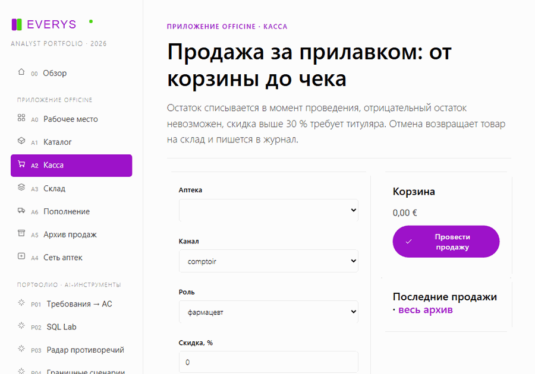
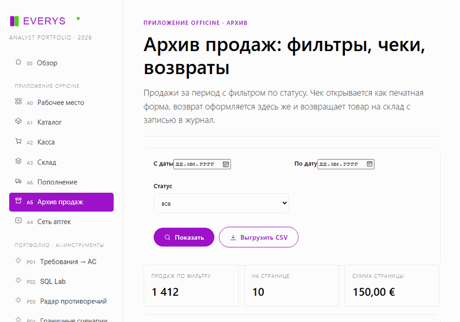
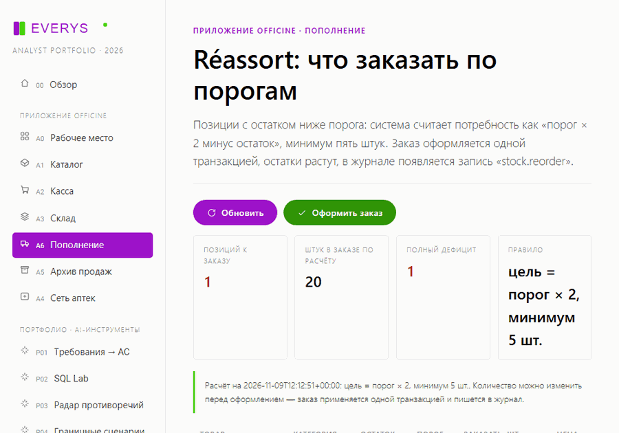

# Everys · Портфолио системного / продуктового аналитика

Учебно-демонстрационный проект под вакансию **системного/продуктового аналитика** в Everys
(Франция, продукт **WinPharma**, Московское представительство компании).

Восемь работающих AI-native инструментов на аптечном домене: от разбора спецификаций и критериев
приёмки до контроля стабильности релиза. Один локальный сервис, один фронтенд, никаких внешних
сервисов и ключей — запускается офлайн на `127.0.0.1`.

```
Everys (Франция) · WinPharma · автоматизация аптек с 1994 года
7000+ аптек · 3 центра разработки: Москва, Бретань, Кремниевая долина
```

---

## Быстрый старт

```powershell
cd everys-analyst-portfolio
$env:PYTHONUTF8 = "1"
$env:PYTHONPATH = "."
python -m uvicorn app.main:app --host 127.0.0.1 --port 8077
```

Открыть <http://127.0.0.1:8077> — интерфейс, <http://127.0.0.1:8077/api/docs> — OpenAPI.

Или одной командой:

```powershell
.\tools\run.ps1
```

Проверка качества (линтер контракта, тесты, дымовой прогон API, синтаксис фронтенда):

```powershell
.\tools\check.ps1
```

**Окружение.** Python 3.11+ (проверено на 3.14.7), FastAPI 0.162, Uvicorn 0.54, httpx, pytest —
всё уже установлено. Node.js нужен только для проверки синтаксиса ES-модулей фронтенда
(`node --check`); сам интерфейс работает в браузере без сборки.

---

## Восемь проектов

| # | Инструмент | Задача аналитика | AI-механика | Эндпоинт |
|---|-----------|------------------|-------------|----------|
| P01 | Требования → критерии приёмки | Входящая user story без AC | BM25-RAG по корпусу + извлечение ограничений + Given/When/Then + проверка поддержки | `POST /api/p01/generate` |
| P02 | SQL Lab | Вопрос на бизнес-языке → цифры | Разбор интента, шаблонный SELECT, guard «только SELECT» и принудительный LIMIT | `POST /api/p02/query` |
| P03 | Радар противоречий | 9 спецификаций противоречат друг другу | Нормализация утверждений, сравнение числовых и модальных значений между документами | `POST /api/p03/scan` |
| P04 | Граничные сценарии | Happy path проверен, границы — нет | Извлечение порогов из спеки, порождение ±1, прав, гонок, идемпотентности | `POST /api/p04/generate` |
| P05 | A/B Lab | Гипотеза принимается «на глаз» | Двухпропорциональный z-тест, доверительный интервал, расчёт размера выборки | `POST /api/p05/test` |
| P06 | Integration Watch | Теледетрансмиссия падает по TLS и таймаутам | Проба endpoint-ов, срок сертификата, версия TLS, SLA-чек, валидатор SOAP-конверта | `POST /api/p06/probe` |
| P07 | Release Gate | Релиз уходит в прод без плана отката | Взвешенная оценка ворот, блокеры, протокол приёмки на RU/FR | `POST /api/p07/assess` |
| P08 | Глоссарий FR↔RU | Московская команда читает французские спеки | Двуязычный поиск по 30 терминам домена, покрытие корпуса, пробелы терминологии | `GET /api/p08/search` |

### Что показывает каждый инструмент

**P01.** «En tant que pharmacien je veux délivrer une ordonnance partiellement…» → набор
критериев `Given / When / Then` с указанием источника (`SPEC-DISP-02#3`), открытые вопросы и
риски. Каждый критерий проверяется на поддержку фрагментом документа — это и есть «обязательная
критическая валидация AI-вывода» из вакансии.

**P02.** Вопрос «Топ-10 препаратов по выручке» превращается в `SELECT … JOIN … GROUP BY … ORDER BY`
по реальной базе (1400 продаж, 3450 строк, 12 аптек, 30 SKU). Любая попытка `DELETE`/`UPDATE`
гасится guard-ом. Свободный SQL тоже можно проверить — он проходит тот же контроль.

**P03.** Корпус собран с намеренными расхождениями: скидка **30 %** (док. 05) против **20 %**
(док. 09), TLS **1.3 обязателен** против **1.2 минимум**, требование переотправлять за **48 часов**
против **24**, температурный режим **2–8 °C** против **2–6 °C**. Радар находит все пары, помечает
критичность и предлагает действие.

**P04.** Из текста «remise maximale autorisée 30 %» рождаются проверки 29,9 / 30 / 30,1 %, плюс
предметные пресеты: последняя единица на двух кассах, второй контроль тем же пользователем,
повторный `idFlux`, скачок температуры 2,1 °C на 31 минуту.

**P05.** Тест на 2400+2400 посетителей с 480 и 528 конверсиями: +10 % относительного прироста,
p = 0,0890, интервал накрывает ноль → вердикт «продолжать тест», а не «раскатывать».

**P06.** Демо-проба трёх целей: у одной истёк сертификат через 12 дней, ответ 503 и 1240 мс —
SLA `blocked`. Живой режим ходит в сеть, но блокирует `localhost` и приватные диапазоны.

**P07.** Восемь ворот с весами; невыполненный план отката обнуляет вердикт при любом суммарном
балле (66 % → `no-go`), и генерируется протокол приёмки на двух языках.

**P08.** 30 терминов `officine` с определениями и примерами: `ordonnance`, `tiers payant`,
`créance`, `rupture`, `CIP13`, `chaîne du froid`, `idFlux`. Поиск работает с обеих сторон и
подсказывает пробелы словаря.

---

## Приложение officine — рабочее место аптеки

Портфолио выросло в работающее приложение: та же база `data/officine.db`, но с записью.
Пять экранов в сайдбаре, группа «Приложение officine».

| Экран | Что делает | Эндпоинты |
|-------|------------|-----------|
| Рабочее место (`#/app`) | Выручка за 30 дней, дефицит, топ препаратов, последние продажи, журнал | `GET /api/app/overview` |
| Каталог (`#/catalog`) | Поиск по названию/DCI/CIP13, правка цены и остатка, пополнение, новый товар, удаление | `GET/POST /api/app/products`, `PATCH/DELETE /api/app/products/{cip}`, `POST …/restock` |
| Касса (`#/counter`) | Корзина, скидка, проведение продажи, чек, отмена | `GET/POST /api/app/sales`, `POST /api/app/sales/{id}/cancel` |
| Склад (`#/stock`) | Позиции ниже порога, быстрое пополнение | `GET /api/app/stock` |
| Пополнение (`#/reorder`) | Расчёт потребности по порогам и заказ одной транзакцией | `GET/POST /api/app/reorder` |
| Сеть аптек (`#/pharmacies`) | Выручка и средний чек по 12 офисинам | `GET /api/app/pharmacies` |

**Инварианты, которые держит бэкенд** (и проверяют 27 тестов в `tests/test_officine.py`):

1. Продажа проходит в одной транзакции `BEGIN IMMEDIATE`: либо списаны все строки и создан чек,
   либо не изменено ничего — при нехватке товара остаток остаётся прежним.
2. Остаток не уходит в минус: запрос больше остатка → `409` с сообщением, сколько есть.
3. Повторяющиеся строки одного CIP складываются — списать дважды из одной позиции нельзя.
4. Роль в кассе: фармацевт — скидка до 30 %, титуляр — до 100 %. Выше лимита → `409`,
   а роль и величина скидки попадают в журнал.
5. Отмена возвращает товар на склад, переводит чек в `annulee`; повторная отмена → `409`.
6. Товар, который уже продавался, удалить нельзя (`409`) — только обнулить остаток.
7. Каждое действие пишется в таблицу `journal`: кто, что, когда, по какому объекту.

Проверить руками: «Касса» → добавить два товара → «Провести продажу» → остаток на «Складе»
уменьшился, в «Рабочем месте» появилась строка в журнале → «Отменить» в списке последних продаж →
товар вернулся на склад, в журнале `sale.cancel`.

Данные изменяемы: после экспериментов вернуть исходное состояние можно командой
`python tools/seed.py` (детерминированный seed, те же 1400 продаж).

---

### Живые сценарии

Записаны Playwright-ом по реальному приложению на `127.0.0.1:8077` — не макеты:

| Сценарий | Что видно |
|----------|-----------|
| Продажа на кассе | поиск по CIP13 → товар в корзине → количество 2 → проведение, остаток списан, чек в «Последних продажах» |
| Возврат из архива | строка продажи → панель возврата с доступным количеством → возврат 1 шт., товар вернулся на склад |
| Пополнение по порогам | позиция с нулевым остатком → заказ одной транзакцией → подтверждение «Заказ №N оформлен» и строка в журнале заказов |







Кадры снимает `tools/record-demos.mjs` (Playwright + Edge), GIF собирает `tools/build-gifs.py`
(Pillow, 900 px, 180 мс на кадр).

---

### Возвраты, архив и выгрузки

- **Возвраты** (`POST /api/app/sales/{id}/return`): частичные и полные. Сумма пересчитывается с учётом
  скидки продажи, товар возвращается на склад, в журнал пишется `sale.return`. Вернуть больше
  проданного или по отменённой продаже нельзя — `409`.
- **История товара** (`GET /api/app/products/{cip}/movements`): продажи, возвраты и пополнения одной
  лентой — видно, откуда взялся остаток.
- **Архив продаж** (`#/sales`): фильтры по дате и статусу, постранично, из строки открываются чек и
  возврат.
- **Печатный чек** (`GET /api/app/sales/{id}/receipt`): самостоятельная HTML-страница с печатными
  стилями, открывается из кассы и архива.
- **Выгрузки** (`/api/app/export/sales.csv`, `…/products.csv`): CSV с `;` и BOM — Excel открывает
  без настройки кодировки; период передаётся теми же фильтрами.
- **Надёжность**: 20 HTTP-тестов через `TestClient`, CHECK-констрейнты в схеме (`prix_public > 0`,
  `stock_actuel >= 0`, `quantite > 0`, `montant_ttc >= 0`), ретрай транзакции при блокировке SQLite
  (до 5 попыток, затем `503`).

---

### Иконки и удобство

- Собственный SVG-набор `app/static/icons.js`: 24 иконки, `stroke="currentColor"`, размеры 14–18 px,
  без внешних шрифтов и CDN. Иконки стоят в навигации и на кнопках действий (обновить, найти,
  выгрузить, сохранить, история, пополнить, вернуть, чек, назад/вперёд).
- Доступность: `focus-visible` с брендовым контуром, `aria-label` у иконочных кнопок (`×` в корзине),
  декоративные иконки помечены `aria-hidden`, подписи для скринридера выводятся классом `sr-only`.
- Пустые состояния показываются иконкой и текстом: пустая корзина, нет товаров по запросу, нет
  продаж по фильтру, нет дефицита.
- Клавиатура: `Enter` в поиске каталога запускает поиск, `Enter` на датах архива применяет фильтр.
- `tools/audit_ui.py` проверяет, что у каждой использованной иконки есть определение в наборе.

---

### Пополнение по порогам (réassort)

Экран `#/reorder` считает потребность по правилу «порог × 2 минус остаток, минимум 5 штук», показывает
разбивку по категориям и полный дефицит. Количество можно поправить прямо в таблице; заказ применяется
одной транзакцией: остатки растут, в журнале появляется `stock.reorder` с номером партии, числом позиций
и штук. Журнал фильтруется по действию — `GET /api/app/journal?action=stock.reorder`.

---

## Связь с требованиями вакансии

| Требование Everys | Где закрыто |
|-------------------|-------------|
| Разбор логики системы и документации, в том числе с AI/RAG | P01, P03, P08 — BM25-ретривер по 9 документам корпуса |
| Проектирование решений, понятные задачи и Acceptance Criteria | P01 (Given/When/Then + источник), P04 (тест-план) |
| Сквозное сопровождение фичи до релиза | P07 (ворота, блокеры, протокол), P04 (границы до приёмки) |
| Поиск граничных сценариев и побочных эффектов | P04, P05 (статистическая проверка гипотезы) |
| Контроль стабильности выпусков | P06 (SLA, TLS, SOAP), P07 (release gate) |
| Клиент-сервер, API, TLS, HTTP, SOAP | P06 — живая проба, TLS 1.2/1.3, контракт SOAP 1.2 |
| Базы данных, SQL (SELECT, JOIN, GROUP BY) | P02 — join по трём таблицам, group by, агрегаты |
| A/B-тестирование и проверка гипотез | P05 — z-тест, CI, power/MDE без scipy |
| LLM/RAG в ежедневной работе + критическая валидация | `app/ai/*` — ретривер, LLM-шлюз, `guard.audit` |
| Работа с неопределённостью и неполными вводными | P03 (противоречия), P01 (открытые вопросы) |
| Французский язык и аптечный домен | Корпус на французском, UI и протоколы на RU/FR, глоссарий |

---

## Контракт стиля кода

Из требований к качеству кода в проекте зафиксирован жёсткий контракт, и он **проверяется
автоматически** (`tools/lint_rules.py`, чистый stdlib, AST-анализ):

1. **Один выход из функции** — ровно один `return`; ранние выходы запрещены (`E003`/`E004`).
2. **Функция — 1–2 строки тела** (`E005`), docstring не считается.
3. **Никаких `while`, `break`, `continue`** (`E001`/`E002`).

Следствие — код написан выражениями: списковые включения, генераторы, dict-dispatch, композиция
маленьких функций вместо ветвлений и накопления в циклах. Исключения, которые контракт допускает
явно: `__init__` и тестовые функции (`test_*`) могут не иметь `return`.

```
python tools/lint_rules.py app projects tools tests
Стиль соблюдён: нарушений нет
```

Эквивалентные настройки для инструментов: `ruff.toml` (`max-statements = 2`, `max-returns = 1`),
`.eslintrc.json` (запрет `while`, `break`, `continue`, `max-statements: 2`),
`linter.rules.toml` — человекочитаемая версия контракта.

---

## Архитектура

```
app/
  main.py              FastAPI: монтирование 8 роутеров, статика, /api/catalog, /api/health
  ai/
    text.py            токенизация FR/RU, лёгкий стемминг, сегментация, похожесть
    retriever.py       BM25-индекс по чанкам: idf, tf, ранжирование, цитаты
    llm.py             OpenAI-совместимый шлюз + честный детерминированный fallback
    guard.py           критическая валидация: поддержка утверждений, доверие, вердикт
  core/
    store.py           загрузка корпуса, чанкинг по разделам, read-only SQLite
    catalog.py         единый каталог проектов для UI, README и API
  officine/            приложение: repo.py (транзакции, журнал), logic.py (сценарии), router.py (API)
  static/              интерфейс: brand.css, ui.js, app.js, views/home + 5 экранов приложения + p01…p08
projects/p01…p08/      logic.py (домен) + router.py (HTTP-контракт)
data/docs/             9 французских спецификаций WinPharma (корпус RAG)
data/glossaire.json    30 терминов домена FR↔RU
data/officine.db       SQLite: officines, produits, ventes, lignes_vente
tools/                 lint_rules.py, seed.py, smoke.py, run.ps1, check.ps1
tests/                 49 тестов: ядро AI и все восемь проектов
brand/brand.json       бренд-токены, снятые с сайта Everys
```

### Данные детерминированы

`tools/seed.py` строит базу с фиксированным seed (20261108), поэтому все цифры в README и на
экранах воспроизводимы: 1400 продаж, 3450 строк, средний чек 26,74 €.

### AI честно устроен

По умолчанию работает локальное детерминированное ядро: BM25-поиск + шаблонная генерация +
критические проверки. Это даёт воспроизводимость и офлайн-запуск. Внешняя LLM подключается без
изменения кода:

```powershell
$env:EVERYS_LLM_BASE_URL = "https://api.openai.com/v1"
$env:EVERYS_LLM_API_KEY  = "…"
$env:EVERYS_LLM_MODEL    = "gpt-4o-mini"
```

Ответ LLM в любом случае проходит `guard.audit`: доля утверждений с опорой на источник, список
неподтверждённых тезисов, вердикт «принять / перепроверить вручную».

---

## Стиль интерфейса

Взят с сайта компании (`moscow.everys.com`, страница вакансий, инлайн-CSS блоков):

| Токен | Значение | Где используется |
|-------|----------|------------------|
| Фиолетовый | `#9e12c9` | кнопки, ссылки, активный пункт меню |
| Зелёный акцент | `#4bd411` / `#62e620` | hover, успешные статусы, второй цвет логотипа |
| Фон | `#fafafa`, карточки `#ffffff` | вся сетка интерфейса |
| Шрифт | Roboto 300/400/500/700 | типографика |
| Радиусы | карточка 5 px, кнопка 30 px | как на сайте |
| Тень | `0 0 10px rgba(0,0,0,.10)`, hover `0 10px 10px` | карточки |
| Логотип | letter-spacing 1.5 px, капитальные | сайдбар |

Скриншоты экранов лежат в `screenshots/view-*.png` (десктоп 1440, ноутбук 1100, мобильный 390).
Вёрстка проверена в headless Edge: на всех 27 комбинациях «экран × ширина» горизонтального
переполнения нет, длинные теги и таблицы переносятся внутри карточек.

---

## E2E через Playwright

```powershell
npm install          # ставит @playwright/test, браузер не скачивается
npm run e2e          # 53 теста: 5 сценариев + 48 проверок вёрстки
npm run e2e:headed   # то же с окном браузера
npm run screenshots  # пересобрать screenshots/view-*.png
```

Браузер берётся установленный — Edge (`channel: "msedge"`), поэтому `playwright install` не нужен.
`playwright.config.mjs` сам поднимает uvicorn на `127.0.0.1:8077` через `webServer`, если сервер не
запущен, и переиспользует уже работающий.

Что покрыто:

- **сценарии** (`e2e/flows.spec.mjs`): продажа из корзины до чека и списание остатка, частичный возврат
  из архива с возвратом товара, заказ пополнения по порогу, поиск и правка цены в каталоге, печатный чек;
- **вёрстка** (`e2e/layout.spec.mjs`): 16 экранов × 3 ширины (1440 / 1100 / 390) — проверяется, что нет
  горизонтального переполнения и элементов за пределами окна;
- тесты сами создают товары через API, поэтому демо-данные не ломаются; при падении сохраняются trace и
  screenshots в `test-results/`.

---

## Тесты

```powershell
$env:PYTHONPATH = "."
python -m pytest -q      # 114 passed: ядро AI, восемь проектов и приложение officine
python tools/smoke.py    # 14 проверок API, все 200
python tools/audit_ui.py # сверка id, адресов API и статики во фронтенде
node tools/ui-smoke.mjs  # 14 экранов рендерятся против живого сервера
```

---

## Границы применимости

Это портфолио, а не продукт: корпус и данные демонстрационные, аутентификации нет, эвристики
заменяют промышленную NLP-модель. Инструменты показывают ход мысли аналитика — как из неполного
требования получается проверяемое решение, — и намеренно не притворяются готовым сервисом.

---

## Отклик

В отклике на вакансию просьба указывать электронную почту.

**hr@everys.com** · Everys / WinPharma · Московское представительство

Version française : [README.fr.md](README.fr.md)
